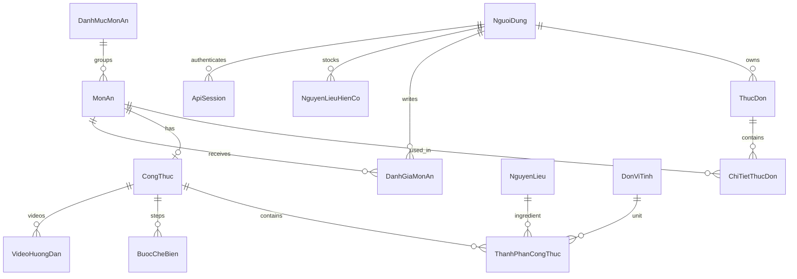

> T?i li?u l?ch s? ??i chi?u migration. Source PHP ?? ???c x?a; c?c ???ng d?n PHP b?n d??i ch? m? t? h? th?ng tr??c ??y. H??ng d?n hi?n t?i: [setup.md](setup.md). T?i s?n n?m trong backend/media; kh?ng c?n c?ch ch?y PHP ho?c rollback b?ng index.php.

# Phân tích và đối chiếu migration CookHub

## Kiến trúc cũ

Đây là PHP thuần, không phải Laravel/Blade hay CodeIgniter mặc dù có thư mục `application/`.

Luồng request:
1. `index.php` nạp `application.php`.
2. `application.php` mở PHP session, đọc `page`/alias và xác định vai trò.
3. POST dùng trường `action`; router gọi các hàm tĩnh trong `DbRepository`.
4. `Database.php` dùng mysqli/prepared statements kết nối MySQL.
5. Kết quả được nhúng vào các view HTML/PHP; POST redirect về GET.

Hồ sơ/yêu thích/nguyên liệu/đánh giá được nạp lại vào session nhiều lần.
Món ăn được map kèm công thức/nguyên liệu bằng nhiều truy vấn theo từng món.
SQL tính giá cũ JOIN toàn bộ lịch sử giá, có thể cộng trùng giá của cùng nguyên liệu.

## Database

ORM giữ nguyên tên bảng, tên cột, PK/FK, kiểu số tiền DECIMAL(18,2) và quan hệ UNIQUE.

| Nhóm | Bảng |
|---|---|
| Tài khoản | NguoiDung |
| Sở thích | KhauVi, CheDoAn, NguoiDung_KhauVi, NguoiDung_CheDoAn |
| Danh mục và món | DanhMucMonAn, MonAn, MonAn_KhauVi, MonAn_CheDoAn |
| Công thức | CongThuc, ThanhPhanCongThuc, BuocCheBien, VideoHuongDan |
| Nguyên liệu | NguyenLieu, DonViTinh, NguyenLieuHienCo, NguyenLieu_ThayThe |
| Giá/dinh dưỡng | GiaNguyenLieu, ThongTinDinhDuong, MucTieuDinhDuong, NganSachAnUong |
| Thực đơn | ThucDon, ChiTietThucDon, DanhGiaDinhDuongThucDon |
| Tương tác | DanhGiaMonAn, NguoiDung_YeuThichMonAn, NguoiDung_KhongThichMonAn |
| PHP tạo khi chạy | MonAnTrangChu, MonAnTrangKhamPha |
| Python bổ sung | ApiSession, PasswordReset |

Tổng cộng 27 bảng gốc, 2 bảng hiển thị và 2 bảng xác thực.

Các quan hệ chính:

Một món có tối đa một công thức do UNIQUE(maMonAn). Một công thức có nhiều thành phần,
bước và video. ChiTietThucDon có ID riêng nên cùng món có thể xuất hiện nhiều lần;
API xóa chính xác một mục bằng ID, không xóa tất cả món trùng nhau.

Không tự tạo cấu trúc DB trong request như PHP. Migration bổ sung chạy riêng, có preflight.
Trên MySQL Windows, tên bảng inspector trả chữ thường; preflight đã xử lý khác biệt này.
Chỉ mục email dùng tiền tố 191 ký tự vì MySQL hiện tại giới hạn khóa InnoDB 767 byte.

## Authentication và authorization

PHP kiểm tra MD5 hoặc password_verify(), lưu authenticated/user_id/role trong session.
Một số POST cá nhân được xử lý dựa vào user mặc định ND002 trước khi có guard theo action;
bản API không có tài khoản mặc định ngầm.

Python:
- Cookie HttpOnly, SameSite=Lax, Secure cấu hình theo môi trường.
- Token ngẫu nhiên; database chỉ lưu SHA-256 token và hạn dùng, mặc định 12 giờ.
- Mỗi request đọc lại trạng thái/vai trò trong DB; không tin role do client gửi.
- Đăng xuất xóa phiên; đổi/reset mật khẩu xóa mọi phiên của tài khoản.
- Đăng ký luôn là NguoiDung; JSON thừa như role bị từ chối.
- Hỗ trợ mật khẩu MD5 và bcrypt PHP ($2y$); nâng lên Argon2 khi login thành công.
- Mọi mutation yêu cầu X-CookHub-Client: web; Origin phải cùng nguồn hoặc thuộc CORS whitelist.
- Tối đa 20 yêu cầu xác thực/phút/IP/process. Triển khai nhiều worker cần limiter dùng kho chung.
- Khôi phục mật khẩu dùng token một lần, 30 phút, gửi qua SMTP cấu hình ngoài.
- Không gửi email thật trong quá trình kiểm thử.

| Vai trò DB | Quyền chính |
|---|---|
| NguoiDung | Catalog, tương tác và dữ liệu cá nhân |
| QuanTriNoiDung | Quyền cá nhân + CRUD nội dung, dashboard |
| Admin | Quyền cá nhân + người dùng, phân quyền, dashboard/báo cáo; lưu món như PHP |

Quyền xóa món và các CRUD nội dung khác thuộc QuanTriNoiDung như PHP.
Không tự mặc định Admin có toàn bộ quyền nội dung.
API mới chặn tự khóa hoặc bỏ quyền Admin của chính mình.

## Đối chiếu routes/actions

Tất cả đường dẫn dưới đây có prefix `/api`. Swagger chứa đầy đủ JSON schema và kiểu tham số.

| PHP page/action | API mới | React |
|---|---|---|
| login/register/logout | POST /auth/login, /auth/register, /auth/logout | Auth, Layout |
| forgot | POST /auth/forgot, /auth/reset | Auth |
| profile/settings | GET/PUT /profile, PUT /auth/password | Profile |
| home/foods/search | GET /dishes, /categories, /units | Catalog |
| suggest | GET /recommendations?mode=… | Catalog |
| dish | GET /dishes/{id}, /dishes/{id}/reviews | Dish |
| favorite | GET /favorites, PUT/DELETE /favorites/{id} | DishCard, Dish |
| hide | GET /hidden, PUT/DELETE /hidden/{id} | Catalog, Profile |
| review | POST /dishes/{id}/reviews | Dish |
| pantry_add/remove | GET/POST /pantry, DELETE /pantry/{id} | Pantry |
| menu_add/remove | GET/POST /menu, DELETE /menu/{item_id} | Menu, Dish |
| menu_save/restore | Lưu ngay khi thêm/xóa; GET /menu/history để mở ngày cũ | Menu |
| category_save/delete | POST /admin/categories, PUT/DELETE /admin/categories/{id} | Admin |
| dish_save/delete | POST /admin/dishes, PUT/DELETE /admin/dishes/{id} | Admin |
| recipe_save/delete | GET/POST /admin/recipes, PUT/DELETE /admin/recipes/{id} | Admin |
| video_save/delete | GET/POST /admin/videos, PUT/DELETE /admin/videos/{id} | Admin |
| review_save/delete | GET /admin/reviews, PUT/DELETE /admin/reviews/{id} | Admin |
| user_save | GET /admin/users, PUT /admin/users/{id} | Admin |
| content/system/reports | GET /admin/stats | Dashboard |
| upload_dish_image/video | POST /uploads/images, /uploads/videos | Admin |

Các HTTP status: 200 đọc/cập nhật, 201 tạo, 202 yêu cầu khôi phục,
204 xóa/đổi mật khẩu, 401 chưa có phiên, 403 thiếu quyền/CSRF,
404 không tìm thấy, 409 trùng hoặc có tham chiếu,
413 quá dung lượng, 415 sai loại tệp, 422 sai đầu vào, 429 quá tần suất, 503 DB/SMTP chưa sẵn sàng.

## Logic được giữ và thay đổi có chủ đích

- Tìm kiếm cũ chỉ lọc tên/mô tả/danh mục; bản mới nối thêm bộ lọc thời gian, độ khó,
  nguyên liệu để các ô này thực sự hoạt động.
- Gợi ý giữ 5 chế độ: ưu tiên yêu thích/đánh giá, khẩu vị, nhóm chế độ ăn, mùa, độ phổ biến.
  Các món ngoài nhóm vẫn được xếp phía sau như PHP. Ẩn gợi ý được lưu DB theo người dùng.
- Chi phí công thức dùng giá gần nhất không nằm trong tương lai, theo cặp nguyên liệu/đơn vị.
  Không giả định chuyển đổi giữa gram, kg, thìa… Chi phí và dữ liệu dinh dưỡng mẫu không phải giá thị trường.
- ID mới dùng UUID rút gọn, tránh cạnh tranh của cách MAX(id)+1.
- Lưu công thức, thay thế nguyên liệu/bước, xóa công thức/món có giao dịch.
  Một đơn vị không tồn tại sẽ rollback toàn bộ thay đổi.
- Dữ liệu cá nhân luôn lấy user_id từ phiên, không cho client chọn user_id.
- React có loading, empty, retry và lỗi trả từ backend; bảo vệ route cả ở UI lẫn API.
- View mới được chia theo trách nhiệm; HTML/PHP không được render lại bằng iframe/chuỗi HTML.
- Giữ assets ảnh hiện có; React chạy độc lập với Apache/PHP.

## Phần PHP chỉ là demo, chưa phải nghiệp vụ hoàn chỉnh

`forgot` cũ chỉ hiện thông báo; đổi mật khẩu dùng alert JavaScript.
Hai phần này đã có API thật, nhưng gửi email cần SMTP.
`menu_save`/`menu_restore` cũ chỉ đặt thông báo, history session không được cập nhật.
Bản mới lưu trực tiếp và đọc lại thực đơn từ DB; không giả tạo chức năng phục hồi snapshot.

Ảnh đại diện, ngày sinh, địa chỉ, dị ứng, thông báo và biểu đồ dinh dưỡng có dữ liệu/điều khiển
hardcode hoặc không được lưu. Bản mới bỏ các điều khiển gây hiểu nhầm.
Chưa bổ sung nghiệp vụ sửa ngân sách/chế độ ăn/mục tiêu dinh dưỡng, quản lý giá,
nguyên liệu thay thế hay tính đánh giá dinh dưỡng: PHP cũng không có controller cho chúng.
ORM vẫn map đầy đủ các bảng để mở rộng về sau.

## Kiểm chứng

- **19 API integration tests passed**: quyền truy cập, MD5/bcrypt, session/revoke, CSRF/CORS, email,
  ownership, menu, recipe rollback, cascade delete, reset một lần, lọc, lịch sử giá,
  upload sai định dạng, không rò password, OpenAPI.
- **9 React tests passed**: JSON/credentials/CSRF, lỗi validation, 204, báo phiên hết hạn,
  multipart, đường dẫn ảnh, đăng nhập, lỗi khôi phục.
- **Production build passed** qua Vite.
- Smoke test trực tiếp trên MySQL: 30 lần đọc API trên ba vai trò, tất cả trả 200.
- Browser smoke chạy trên localhost: các trang người dùng/quản trị, thao tác lưu,
  kích thước desktop và mobile. Tài khoản và dữ liệu tạo trong thử nghiệm được dọn riêng.
- SMTP thực và deployment HTTPS chưa được thử vì chưa có cấu hình môi trường đó.

## Cutover và rollback

1. Sao lưu database và assets; giữ bản code PHP.
2. Cài thư viện, cấu hình .env; chạy preflight và migration.
3. Chạy backend + frontend, kiểm tra ba vai trò với dữ liệu thực.
4. Khi đưa lên server: build React, route SPA về index.html, proxy API/assets tới Python, bật HTTPS.
5. Muốn quay lại PHP: chuyển web route về index.php. Các bảng mới không cản PHP.
   Lưu ý hash Argon2id cần PHP hỗ trợ; cân nhắc khôi phục dữ liệu từ bản sao lưu nếu cần
   quay lại chính xác trạng thái trước migration, vì việc đó sẽ mất các thay đổi phát sinh sau sao lưu.

